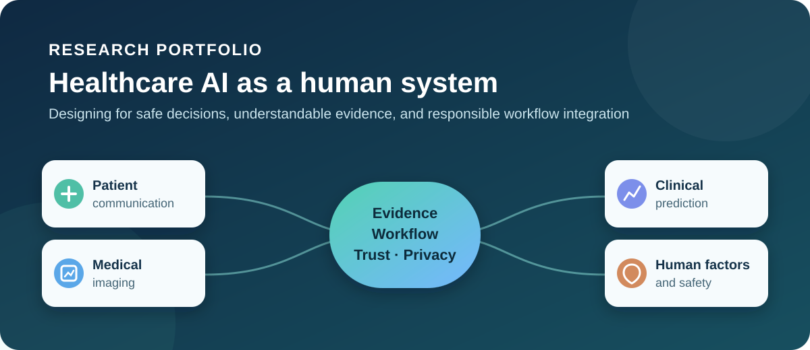

<p align="center">
  
</p>

<p align="center">
  <a href="README.md">English</a> · <strong>繁體中文</strong> · <a href="README.ja.md">日本語</a>
</p>

# 研究作品集 — 醫療人工智慧與人因工程

我目前是醫學資訊領域的碩士生。這個儲存庫用來記錄我在醫療 AI、醫學影像與人因工程方面的學習和研究。我關心的不只是模型表現，也關注使用者能否安全操作、理解證據、在錯誤發生時恢復，並避免對模型產生不恰當的信任。

> **紀錄狀態：** 持續整理中的課程與研究紀錄。所有系統皆為研究或課程原型，不是臨床產品。缺少的資訊以 `TODO` 標示，沒有自行捏造結果。

## 一目了然

| | |
|---|---|
| **目前階段** | 醫學資訊領域碩士生 |
| **目前關注** | 醫療 AI、醫學影像與人因工程 |
| **研究興趣** | 醫學影像、病人溝通、臨床 NLP、決策支援、工作流程安全 |
| **核心觀點** | 證據、工作負荷、可用性、信任校準、隱私與錯誤恢復 |
| **個人資料** | 鍾宜成（CHUNG YI CHENG）；臺北醫學大學醫學資訊研究所碩士在職專班在學 |

## 代表作品

| 專案 | 本作品集採用的證據 | 我的角色 | 人因工程連結 |
|---|---|---|---|
| [結合 EHR 與 RAG 的個人化病人衛教](projects/patient-education-rag/README.md) | 本機 LLaMA 3.2、檢索與引用控制、Streamlit 介面、自動與人工評估 | 已有實作證據；獨立／團隊工作的精確歸屬仍為 `TODO` | 健康識能、證據呈現、信任校準、隱私 |
| [胸部 X 光品質控制與氣胸偵測](projects/chest-xray-quality-control/README.md) | 兩階段 CNN、混淆矩陣、失敗分析、Gradio 介面 | 小組專案；個人報告記錄基準測試、CNN 除錯、兩階段重構與 UI 工作；隊員歸屬為 `TODO` | 捷徑學習、偽陰性、影像品質流程、人類覆核 |
| [ASA 身體狀態分級預測](projects/asa-physical-status-classification/README.md) | 個人課程競賽、臨床特徵工程、加權集成、排行榜紀錄 | 個人專案；資料與競賽來源仍為 `TODO` | 可解釋性、資料洩漏控制、臨床風險溝通 |
| [標籤分布偏移下的生醫文字分類](projects/biomedical-text-classification/README.md) | PubMedBERT／BioLinkBERT、分組驗證、資料品質消融 | 已有實驗紀錄；程式來源為 `TODO` | 分布偏移下的可靠性與對指標的適當信任 |
| [MRI radiomics 與腫瘤微環境](projects/mri-radiomics-review/README.md) | 影像生物標記與臨床轉譯的小組文獻整理 | 小組作業；個人負責內容為 `TODO` | 可解釋性、分割變異、臨床整合 |
| [MRI 影像的 AI 應用](projects/masters-thesis/README.md) | 僅公開概括研究方向 | 碩士研究進行中 | 未公開細節暫不揭露 |

## 研究問題

如何把醫療 AI 設計並評估為人機系統的一部分，使其協助正確決策、降低不必要的工作負荷、清楚傳達證據與不確定性，同時避免使用者產生不恰當的依賴？

## 成果證據摘要

下列數值都能在目前工作區的來源檔案中找到。樣本數、假設與限制請參閱各專案頁面。

| 專案 | 已記錄證據 | 解讀界線 |
|---|---|---|
| 病人衛教 RAG | 20 個示範案例：生成成功率與引用標記出現率皆為 100%；單一評估者檢查 10 案：Hit@3 90%、引用正確率 70%、幻覺率 30% | 原型評估；出現引用標記不代表引用內容正確 |
| 胸部 X 光原型 | 方向判定 CNN：800 張影像 macro F1 0.96；氣胸 CNN：600 張影像 macro F1 0.79 | 可能存在配對影像洩漏與跨資料集混雜；不是臨床驗證 |
| ASA 分級 | Public score 0.56536；Private score 0.55817 | 課程競賽證據；評分定義、網址與資料來源為 `TODO` |
| 生醫文字分類 | 使用類別平衡資料選擇後，紀錄的公開分數為 0.66273 | 課程／競賽實驗；內部驗證不等同排行榜結果 |

## 我的貢獻

- 建立或整理橫跨 RAG、臨床表格分類、生醫 NLP 與醫學影像的本機 AI 原型。
- 保留幻覺、錯誤引用、資料分布偏移、捷徑學習與偽陰性等負面結果，不以單一漂亮分數掩蓋問題。
- 將模型表現連結到工作負荷、可用性、隱私與人類監督等問題。
- 小組專案的作者貢獻與合作夥伴歸屬仍在確認中；各專案頁區分已有紀錄的個人工作與尚待確認的細節。

## 資料集與方法

- **病人衛教：** 本機使用 100 筆 MIMIC-IV demo 衍生資料與 225 份院方核可衛教文件；來源資料與個案層級衍生內容均未公開。
- **胸部 X 光：** 本機使用 NIH 衍生正常影像、SIIM-ACR 氣胸影像與自行產生的水平翻轉影像；沒有公開影像或 DICOM。
- **ASA 分級：** 本機檔案包含 14,734 筆訓練資料與 6,315 筆測試資料，含病患層級臨床欄位；在來源與授權確認前全部排除。
- **生醫文字分類：** 資料集名稱、授權、類別定義與完整數量仍為 `TODO`。
- **MRI radiomics：** 僅為文獻回顧，沒有原始實驗資料集。
- **碩士論文：** 資料與方法細節刻意不公開。

方法涵蓋本機 RAG、生醫 Transformer、結構化／文字特徵工程、梯度提升集成、CNN、介面原型與批判性文獻整理。沒有任何方法被描述為已完成臨床驗證。

## 錯誤分析與學習

- 引用格式不等於引用正確；RAG 人工檢查同時發現幻覺與錯誤引用。
- 胸部 X 光 CNN 初期崩潰為單一類別；後續方向判定結果仍可能因原圖與翻轉圖跨越資料切分而被高估。
- 氣胸模型的正常與陽性影像來自不同資料來源，可能學到資料集或設備差異；顯示的 300 個陽性案例中有 82 個被判為正常。
- ASA 最終程式使用 transductive preprocessing 與偽標籤測試資料，其交叉驗證不能視為獨立真實標籤評估。
- 生醫文字分類的內部驗證與公開排行榜行為不一致，顯示需要明確處理分布偏移。

這些失敗正是我想研究人因工程的原因：系統必須讓不確定性與限制可見，並在模型出錯時支援安全恢復。

## 限制

- 多數成果來自回溯式課程作業或原型開發。
- 部分評估樣本小、僅有單一評估者、依賴競賽結果，或可能受到資料洩漏與分布偏移影響。
- 普遍缺少外部、前瞻、多中心、校準、子群與讀者研究。
- 部分專案的資料授權與精確個人貢獻仍未完成文件化。
- 公開 repository 刻意排除完整重現所需的敏感資料。

## 重現方式

目前唯一選擇公開執行的程式是去除資料的病人衛教原型：

```text
git clone https://github.com/eifel870410-glitch/healthcare-ai-research-portfolio.git
cd healthcare-ai-research-portfolio/NLPLLMCLASS/patient_edu_rag
python -m venv .venv
<啟用虛擬環境>
pip install -r requirements.txt
```

接著依照[設定說明](NLPLLMCLASS/patient_edu_rag/README.md)操作。使用者必須自行提供合法授權的資料。胸部 X 光、ASA、文字分類與碩論專案，在程式來源、授權與環境尚未確認前，重現步驟維持 `TODO`。

## 倫理與隱私

- 沒有公開病患 DICOM、臨床影像、病患層級 CSV、IRB 文件、院內表單、帳密、API key、模型權重或個案層級輸出。
- Repository 採用預設全部排除的 `.gitignore`，並搭配本機[公開安全掃描器](scripts/check_public_safety.py)。
- 公開示例應使用合成或明確授權資料，並正確標示來源與性質。
- 競賽分數與原型指標不得描述為臨床有效性證據。

## Repository 導覽

- [`projects/`](projects/) — 使用共同研究欄位撰寫的專案頁面。
- [`NLPLLMCLASS/patient_edu_rag/`](NLPLLMCLASS/patient_edu_rag/) — 經過檢查、不含資料的衛教原型程式。
- [`docs/research-direction.md`](docs/research-direction.md) — 研究興趣與學習紀錄。
- [`docs/publishing-checklist.md`](docs/publishing-checklist.md) — 隱私、作者貢獻、授權與研究主張檢查。

## 待補的紀錄

- 視需要補上確認後的預計畢業時間、學術信箱與 ORCID。
- 確認每個小組專案的 **Your role** 與隊員歸屬。
- 補上權威資料集、競賽與授權連結。
- 視需要翻譯個別專案頁面，並先確認內容正確。
- 每次更新公開內容前，重新檢查隱私與研究主張。

