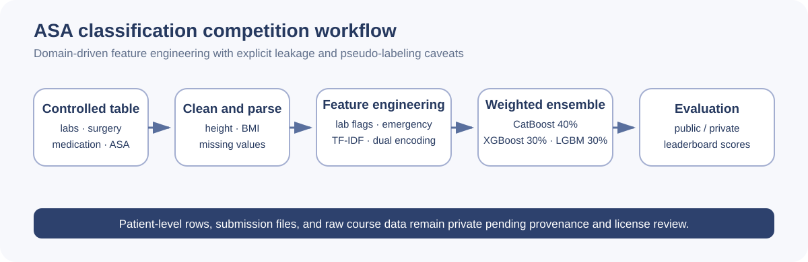

# ASA Physical Status Classification from Mixed Clinical Data

> Individual course competition project. The recorded leaderboard scores are not evidence of clinical validity.

## Project overview

This project predicted ASA physical-status classes from a mixed clinical table containing numeric variables, categorical fields, surgery text, medication text, and laboratory-value strings. The work progressed from basic classifiers to a domain-informed weighted ensemble.

## Problem

The table mixed units, missing values, high-cardinality categories, and semi-structured clinical text. Basic encoding and off-the-shelf classifiers did not capture these relationships well, particularly under class imbalance.

## Research question

Can clinically motivated parsing and feature engineering, combined with heterogeneous gradient-boosting models, improve multiclass ASA prediction in a course competition without relying only on model complexity?

## Your role

The source materials label this as an individual competition report. I documented and implemented:

- height parsing, BMI calculation, missing-value handling, and clipping of extreme BMI values;
- regular-expression extraction of creatinine, hemoglobin, and leukocyte values;
- laboratory abnormality counts and emergency keyword features;
- medication TF-IDF features;
- K-fold target encoding and label encoding for high-cardinality categories;
- CatBoost, XGBoost, and LightGBM experiments and a weighted ensemble; and
- pseudo-labeling and leaderboard comparison across multiple submissions.

**TODO:** add the official competition link, submission identity, course rules, and code provenance before using ranking claims.

## Dataset

The local files contain:

- 14,734 training rows with 12 input columns plus `ASA_Rating`;
- 6,315 test rows with the same 12 input columns but no target; and
- fields for gender, ICU status, age, height, weight, anesthesia method, patient source, surgery name, medication usage, laboratory values, a display-properties field, and catheter use.

The source, license, de-identification method, and permission to redistribute are not documented sufficiently. The row-level CSV files are therefore excluded from this repository even though direct names were not visible in the column headers.

## Methodology

1. Parse imperial and numeric height representations and compute BMI.
2. Clip BMI to a recorded range of 10 to 80.
3. Extract selected laboratory values with regular expressions.
4. Count `(H)` and `(L)` flags and detect emergency-related keywords.
5. Use median imputation for numeric variables and `Missing` for categorical variables.
6. Apply 5-fold target encoding for surgery categories and label encoding for CatBoost inputs.
7. Fit medication TF-IDF using 30 features.
8. Combine CatBoost (40%), XGBoost (30%), and LightGBM (30%) probabilities.
9. Add pseudo-labeled test rows at sample weight 0.25 in the recorded final approach.

## Experimental setup

- Five-fold stratified cross-validation is recorded in the final script.
- Random seed: 42.
- CatBoost: 2,000 iterations, learning rate 0.015, depth 6.
- XGBoost and LightGBM: 1,500 estimators with learning rate 0.02 in the recorded script.
- Evaluation records include micro/macro precision, recall, F1, and public/private leaderboard scores.
- **TODO:** document the competition metric definition, class distribution, hardware, package versions, submission dates, and whether the competition permitted the transductive and pseudo-labeling steps.

## Results

The individual report records the following for the `final_shot` submission:

| Evidence | Recorded value | Caveat |
|---|---:|---|
| Public leaderboard score | 0.56536 | Competition link and metric definition are TODO |
| Private leaderboard score | 0.55817 | Not a clinical validation result |
| Recorded cross-validation macro precision / recall / F1 | 0.62521 / 0.63978 / 0.62620 | The final script mixes pseudo-labeled test rows into the cross-validation pool; do not interpret as independent ground-truth validation |

The report also records much lower results for basic Naive Bayes, logistic-regression, decision-tree, KNN, and SVM experiments. These baselines motivated the later feature-engineering and ensemble work.

No overall competition rank is claimed here. The report contains both an overall private-leaderboard rank and within-report method ordering; an authoritative leaderboard URL is required before publishing a ranking.

## Error analysis

- Manual keyword rules can miss spelling variants, abbreviations, or uncommon clinical terminology.
- Median imputation ignores clinical relationships among variables.
- TF-IDF and category encoders were fitted using combined train and test features in the final script, which is transductive and may not match a real deployment setting.
- Pseudo-labels can reinforce errors and confirmation bias.
- Cross-validation that includes pseudo-labeled test rows is not a clean estimate against known ground truth.
- A small public/private score gap is compatible with stability but does not prove generalization or absence of overfitting.

## Limitations

- Dataset provenance, license, and de-identification documentation are incomplete.
- Competition scores cannot establish clinical usefulness, fairness, or calibration.
- No external hospital, temporal, or prospective validation is documented.
- No subgroup analysis, uncertainty calibration, or clinician comparison is documented.
- The current source scripts contain hard-coded local paths and automatic package installation.

## Lessons learned

- Domain-informed cleaning and feature engineering can matter more than adding model complexity to noisy clinical tables.
- Leakage prevention must cover target encoding, text vocabulary fitting, category preprocessing, and pseudo-label evaluation—not only the final classifier.
- Leaderboard performance and deployment evidence answer different questions.
- Clinically plausible rules still require empirical validation and careful failure analysis.

## Reproduction instructions

Full reproduction is withheld until data access and competition rules are documented.

1. Obtain the authorized dataset and confirm the competition rules.
2. Replace hard-coded paths with configuration.
3. Fit every preprocessing step inside training folds.
4. Evaluate pseudo-labeling separately from ground-truth cross-validation.
5. Pin library versions and record random seeds and hardware.
6. Publish only a data-free training pipeline and schema-level synthetic example.

**TODO:** add the competition URL, data dictionary, license, cleaned executable code, requirements, and an independently evaluated baseline.

## Ethics and privacy

- The local CSV files contain patient-level clinical attributes and are not uploaded.
- Absence of a direct name or medical-record-number column does not establish that a dataset is safe to publish.
- Surgery, medication, laboratory, and demographic combinations may remain sensitive or identifying.
- Any future public example should be synthetic and clearly labeled as synthetic.
- The model must not be used to assign ASA status or make clinical decisions.

