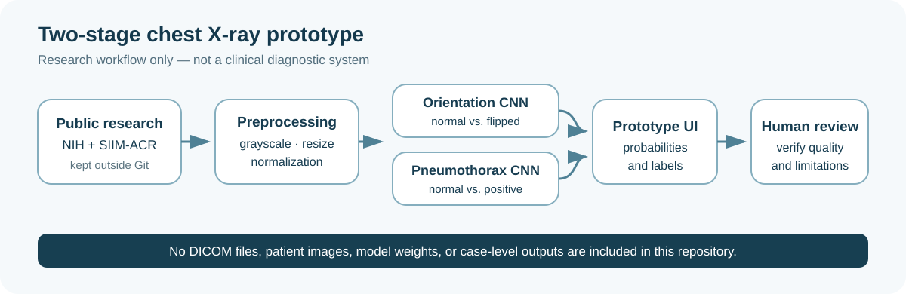

# AI-Assisted Chest X-Ray Quality Control and Pneumothorax Detection

> Course group prototype. This system is not clinically validated and must not be used for diagnosis or patient care.

## Project overview

This project explored whether one prototype could flag two different problems before or during chest X-ray review: a left-right orientation error and a possible pneumothorax. The final course implementation separated the task into two binary convolutional neural networks and displayed their probabilities in a Gradio interface.

## Problem

High-volume imaging workflows can be affected by fatigue, delayed review, acquisition or orientation errors, and missed urgent findings. A useful support tool must distinguish quality-control problems from pathology, expose uncertainty, and keep a person responsible for the final decision.

## Research question

Can a two-stage image-classification prototype distinguish normal orientation from horizontal flipping and normal images from pneumothorax examples, while presenting both outputs in a form suitable for human review?

## Your role

This was a four-person group project. A personal experiment report in the source materials records that I:

- ran an initial logistic-regression experiment locally;
- moved CNN training to Google Colab when local hardware was insufficient;
- investigated an initial CNN failure in which nearly every input was classified as `flipped_lr`;
- restructured the task into two binary CNNs; and
- added an interface for JPG/PNG and DICOM input with model probabilities and predicted labels.

**TODO:** confirm the exact ownership of the final training script, interface code, slides, dataset preparation, and analysis; credit each teammate before using this page in an application.

## Dataset

The source materials identify two public research datasets:

- NIH ChestX-ray14 or a locally organized NIH-derived archive for normal chest X-rays;
- SIIM-ACR Pneumothorax Segmentation data for pneumothorax-positive DICOM images; and
- horizontally flipped copies of normal images as the orientation-error class.

The final training script samples up to 2,000 NIH normal images for the orientation experiment, creating 2,000 additional flipped images. It separately samples up to 1,500 NIH normal and 1,500 SIIM pneumothorax-positive images for the pathology experiment.

No source image, DICOM file, label table, model weight, or case-level output is included here. **TODO:** add authoritative dataset URLs, versions, access dates, and license terms before claiming full reproducibility.

## Methodology

- Convert inputs to one-channel grayscale.
- Resize to 256 x 256 pixels.
- Normalize PNG intensity by 255; apply min-max normalization to DICOM pixel arrays.
- Use four `Conv2D` blocks with batch normalization and max pooling, followed by a dense layer, dropout, and sigmoid output.
- Train two independent binary models:
  - normal orientation vs. horizontally flipped;
  - normal vs. pneumothorax positive.
- Use Adam with learning rate `1e-4`, binary cross-entropy, early stopping, and learning-rate reduction.
- Display both model probabilities in a Gradio prototype.

## Experimental setup

- Random seed: 42.
- Test split: 20%, stratified by class.
- Validation split: 20% of the training portion.
- Maximum epochs: 30.
- Batch size: 32.
- Recorded test support: 800 images for orientation and 600 images for pneumothorax.
- **TODO:** document the exact dataset snapshot, Colab runtime/GPU, package versions, training date, and whether any duplicate patients or images crossed splits.

## Results

Only values visible in the final course presentation are reported.

| Experiment | Recorded result | Evaluation support | Interpretation boundary |
|---|---:|---:|---|
| Logistic-regression three-class baseline | Macro precision 0.6862; recall 0.6883; F1 0.6870 | 1,200 predictions in the displayed confusion matrix | Baseline experiment; split construction requires further documentation |
| Initial three-class CNN | 0 / 900 predictions assigned to normal or pneumothorax; all 900 assigned to `flipped_lr` | 900 predictions | Failed experiment retained for error analysis |
| Orientation binary CNN | Accuracy and macro F1 0.96 | 800 images | May be inflated by paired-image leakage; see below |
| Pneumothorax binary CNN | Accuracy and macro F1 0.79 | 600 images | Research-dataset result, not clinical performance |

For the pneumothorax model, the displayed confusion matrix is `[[255, 45], [82, 218]]`. If class 1 is pneumothorax as documented in the training code, 82 positive examples were predicted as normal; this is a false-negative count, not a false-positive count.

## Error analysis

- The initial CNN learned non-diagnostic appearance differences and collapsed to the `flipped_lr` class.
- NIH normal images and SIIM positive images come from different sources. A model can learn dataset, acquisition, or preprocessing differences instead of pneumothorax pathology.
- The orientation dataset is formed by creating a flipped copy of each normal image before a random train/test split. A source image and its transformed counterpart could therefore appear on opposite sides of the split, inflating the recorded 0.96 result.
- The pneumothorax model missed 82 of 300 displayed positive examples, making false-negative review a central safety concern.
- The interface displayed probabilities, but no calibration analysis, threshold study, reader study, or usability evaluation was documented.

## Limitations

- Retrospective course prototype with no external or prospective validation.
- No patient-level split documentation.
- No calibration, confidence interval, subgroup, scanner/site, or robustness analysis.
- Cross-dataset confounding is not controlled.
- Team attribution is incomplete.
- The source code is notebook-oriented, contains local paths, and is not yet packaged for reproducible execution.

## Lessons learned

- A high score can reflect shortcut learning or split leakage rather than useful clinical signal.
- Quality-control errors and pathology should be evaluated separately because their risks and data-generating mechanisms differ.
- Failure cases and confusion-matrix direction matter more than a single aggregate metric in a safety-critical workflow.
- A human-facing interface needs calibrated uncertainty, explicit limitations, and a clear escalation path rather than only a predicted label.

## Reproduction instructions

Reproduction is intentionally not enabled yet because the raw scripts depend on local dataset layouts and the dataset/version documentation is incomplete.

1. Obtain the permitted research datasets from their authoritative sources.
2. Verify license and access requirements.
3. Build a patient-level or source-image-grouped split before augmentation.
4. Replace hard-coded Colab paths with configuration or command-line arguments.
5. Pin package versions and publish only data-free code.
6. Re-run the leakage, calibration, and subgroup checks before reporting results.

**TODO:** publish a cleaned training script, inference-only demo using synthetic or explicitly licensed examples, package lockfile, and exact commands.

## Ethics and privacy

- No DICOM, chest X-ray, patient record, model output, or model weight from the source project is published.
- Publicly accessible research datasets can still carry use restrictions and re-identification risk; access does not automatically justify redistribution.
- An uploaded DICOM may contain metadata beyond pixel data. A portfolio demo should use synthetic or explicitly authorized examples and remove metadata before any public display.
- The prototype must not be presented as a diagnostic device or evidence of clinical effectiveness.

